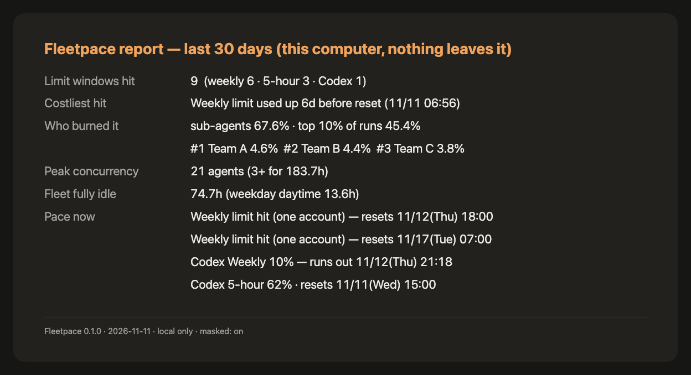
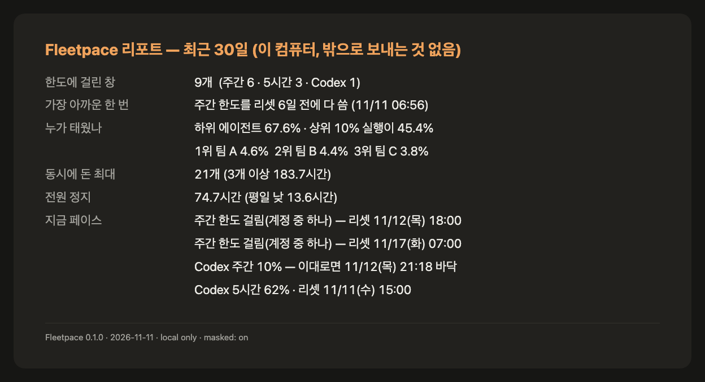
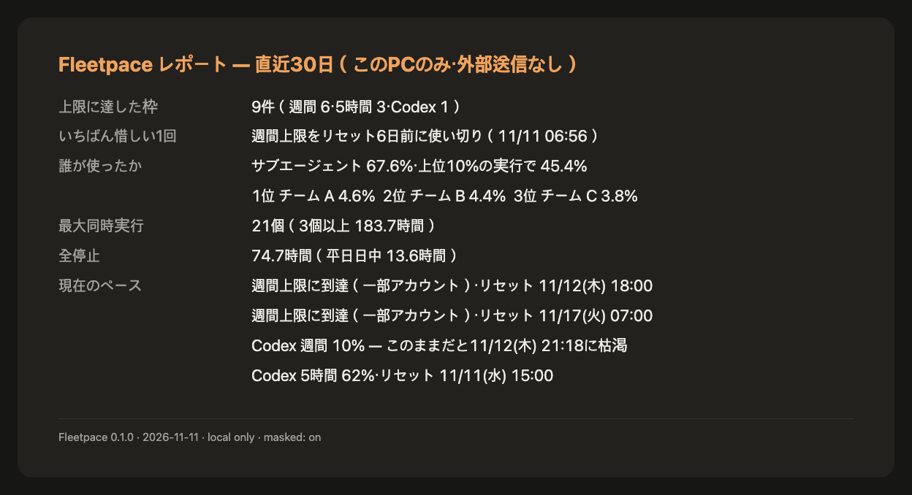
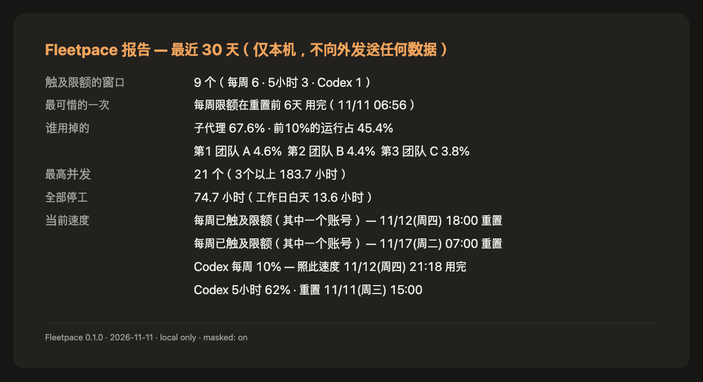

# Fleetpace

**When will my agents hit the limit, and who is burning it?** A one-file, local report for people who run many AI coding agents at once. Works with Claude Code and Codex logs (unofficial, not affiliated with Anthropic or OpenAI).



*A real report from our own studio (one person + about 20 Claude Code / Codex agents at peak). Team names are masked by default.*

<details>
<summary>Also in 한국어 · 日本語 · 中文</summary>





</details>

```
node fleetpace-report.mjs            # 30-second report of the last 30 days
node fleetpace-report.mjs status --json   # pace right now, one JSON object (for scripts and lead agents)
```

Needs Node 18+. No install, no dependencies, no network.

## Use it as a Claude Code plugin

```
/plugin install fleetpace --marketplace rivermountain-studio/fleetpace
```

Or from your shell:

```
claude plugin marketplace add rivermountain-studio/fleetpace
claude plugin install fleetpace@rivermountain-studio
```

Then, inside Claude Code:

- `/fleetpace:report` — the 30-day report (`/fleetpace:report --lang ko`, `--days 7`, `--html`)
- `/fleetpace:status` — pace right now as JSON. Claude also uses it on its own before starting a large team of sub-agents, and asks you first if the verdict is `tight` or `blocked`.

The plugin is two skills that run the same `engine-node/fleetpace-report.mjs` file shown above. It adds no hooks, no MCP server and no network access, and keeps names masked unless you ask for `--no-mask`. Remove it with `claude plugin uninstall fleetpace@rivermountain-studio`.

## What it reads and what it never reads

| Reads | Never reads |
|---|---|
| line timestamps and line kinds (user / assistant) | conversation text, prompts, code, tool output |
| token counts (`usage`) and model names | credentials, `.credentials.json`, `auth.json`, keychain |
| rate-limit error fields (`error`, `quotaLimits.rateLimitType`, `resetsAt`) | anything on the network (the file has no network code) |
| sub-agent label: first word of `.meta.json` description | your settings files (nothing is written there) |
| Codex `token_count.rate_limits` snapshots | |

Output masks team labels and folder names by default (`--no-mask` to show them). The only file it writes is an optional cache at `~/.fleetpace/cache-v1.json` (numbers only; delete the folder to remove every trace) and the HTML card if you ask for `--html`.

## What you get

- **Limit windows hit** in the period, and the costliest one: "weekly limit used up 5.7 days before reset".
- **Who burned it**: sub-agents vs lead session, share of the top 10% of runs, top teams (approximate weighted tokens).
- **Peak concurrency** and hours with 3+ agents running.
- **Fleet fully idle** hours (no lead or sub-agent working).
- **Pace now**: Codex percentages as Codex recorded them; Claude Code pace estimated from your past limit hits (always marked "about").

Languages: `--lang ko|en|ja|zh`. Full options: `--help`.

## License
MIT for `engine-node/`. See `LICENSE`.

---

# Fleetpace (한국어)

**내 에이전트들이 한도에 언제 걸리고, 누가 태우고 있나?** AI 코딩 에이전트를 여러 개 돌리는 사람을 위한, 파일 하나짜리 로컬 리포트입니다. Claude Code·Codex 기록과 함께 씁니다(비공식, Anthropic·OpenAI 와 관계없음).

```
node fleetpace-report.mjs                 # 최근 30일, 30초 리포트
node fleetpace-report.mjs status --json   # 지금 페이스 한 덩어리 (스크립트·지휘 에이전트용)
```

Node 18 이상. 설치·의존성·네트워크 없음.

## Claude Code 플러그인으로 쓰기

```
/plugin install fleetpace --marketplace rivermountain-studio/fleetpace
```

터미널에서는:

```
claude plugin marketplace add rivermountain-studio/fleetpace
claude plugin install fleetpace@rivermountain-studio
```

Claude Code 안에서:

- `/fleetpace:report` — 30일 리포트 (`/fleetpace:report --lang ko`, `--days 7`, `--html`)
- `/fleetpace:status` — 지금 페이스 JSON. 하위 에이전트를 여럿 띄우기 전에 Claude 가 스스로 보고, `tight`·`blocked` 이면 먼저 묻습니다.

플러그인은 위의 같은 `engine-node/fleetpace-report.mjs` 를 돌리는 스킬 2개뿐입니다. 훅·MCP 서버·네트워크를 더하지 않고, `--no-mask` 를 직접 말하지 않으면 이름을 가립니다. 지우기: `claude plugin uninstall fleetpace@rivermountain-studio`.

## 읽는 것 / 절대 안 읽는 것

| 읽는 것 | 안 읽는 것 |
|---|---|
| 줄의 시각과 종류(사용자/답) | 대화 글·프롬프트·코드·도구 출력 |
| 토큰 숫자(`usage`)와 모델 이름 | 자격 증명·`.credentials.json`·`auth.json`·키체인 |
| 한도 오류 칸(`error`, `quotaLimits.rateLimitType`, `resetsAt`) | 네트워크(파일 안에 네트워크 코드가 없음) |
| 하위 에이전트 이름표: `.meta.json` 설명의 첫 낱말 | 설정 파일(아무것도 쓰지 않음) |
| Codex `token_count.rate_limits` 기록 | |

이름표·폴더 이름은 기본으로 가립니다(`--no-mask` 로 보기). 쓰는 파일은 선택 캐시 `~/.fleetpace/cache-v1.json`(숫자만, 폴더를 지우면 흔적 0)과 `--html` 을 줬을 때의 카드 파일뿐입니다.
